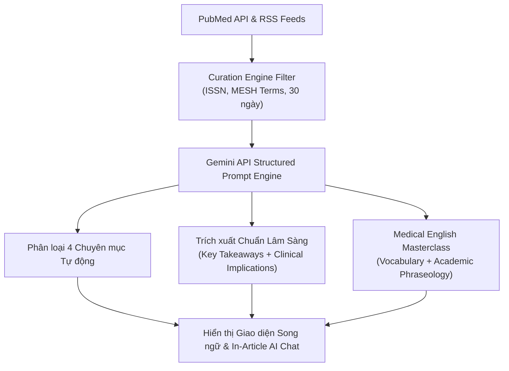

# MedBrief Endocrinology & Diabetes
> Automated Medical Curation Engine & Medical English Masterclass
> Hệ thống Thu thập, Tinh chọn Y văn Tự động & Học Tiếng Anh Y khoa Chuyên sâu.

---

## 1. Danh mục 8 Tạp chí Quốc tế Ưu tiên (High-Impact & Specialty Journals)

Hệ thống tập trung tuyệt đối vào các tạp chí hàng đầu trong chuyên ngành **Nội tiết - Chuyển hóa & Đái tháo đường**, được gán nhãn **Huy hiệu Pastel (Journal Badge)** độc quyền:

| Tạp chí | ISSN | Nhận diện Pastel (Light / Dark) | Trọng tâm Chuyên môn |
| :--- | :--- | :--- | :--- |
| **The Lancet Diabetes & Endocrinology** | `2213-8587` | Hồng Ruby (`#FFE4E6` / `rgba(225,29,72,0.16)`) | Thử nghiệm lâm sàng pha III lớn, dịch tễ học, khuyến cáo practice-changing về đái tháo đường & béo phì. |
| **Diabetes Care (ADA)** | `0149-5992` | Xanh Lam Sáng (`#E0F2FE` / `rgba(14,165,233,0.16)`) | Tiêu chuẩn chăm sóc (Standards of Care), công nghệ CGM, bơm insulin, biến chứng. |
| **JCEM (Endocrine Society)** | `0021-972X` | Tím Iris (`#EDE9FE` / `rgba(139,92,246,0.16)`) | Lâm sàng tuyến giáp, tuyến yên, thượng thận, loãng xương, chuyển hóa canxi, nội tiết sinh sản. |
| **Endocrine Reviews** | `0163-769X` | Tím Thạch Anh (`#F3E8FF` / `rgba(168,85,247,0.16)`) | Systematic Review và Meta-analysis về cơ chế bệnh sinh, trục HPA, đích điều trị mới. |
| **Thyroid (ATA)** | `1050-7256` | Xanh Ngọc Bích (`#CCFBF1` / `rgba(20,184,166,0.16)`) | Quản lý nhân giáp, ung thư giáp, hướng dẫn đồng thuận của ATA. |
| **Diabetologia (EASD)** | `0012-186X` | Vàng Mật Ong (`#FEF3C7` / `rgba(245,158,11,0.16)`) | Y học dịch chuyển (Translational medicine), nghiên cứu EASD châu Âu, tế bào beta tụy. |
| **NEJM** | `0028-4793` | Đỏ Rượu Vang (`#FCE7F3` / `rgba(219,39,119,0.16)`) | Thử nghiệm bản lề thuốc mới (GLP-1 RA, SGLT2i, Tirzepatide, CagriSema). |
| **The Lancet & JAMA** | `0140-6736` | Xanh Lục Bảo (`#DCFCE7` / `rgba(34,197,94,0.16)`) | Thử nghiệm đa trung tâm toàn cầu, đồng thuận và hướng dẫn quốc tế. |

---

## 2. Quy trình Xử lý Tự động của AI (Gemini Curation Pipeline)

### Các Chuyên mục Phân loại:
1. `[Đái tháo đường & Béo phì]` (Diabetes & Obesity)
2. `[Tuyến giáp]` (Thyroid Disorders)
3. `[Nội tiết chung / Thượng thận / Xương]` (General Endo, Adrenal & Bone)
4. `[Thử nghiệm lâm sàng lớn]` (NEJM/Lancet Landmark Trials)

---

## 3. Tính năng Chi tiết Bài Báo (Article Detail View)

1. **Bộ chuyển đổi Chế độ Hiển thị**:
   - `[🌐 Song ngữ Anh - Việt]`: Hiển thị song song tiêu đề, tóm tắt và thực hành lâm sàng.
   - `[🇻🇳 Chỉ Tiếng Việt]`: Tối ưu đọc nhanh cho ca trực.
   - `[🇬🇧 English Only]`: Dành cho bác sĩ muốn luyện đọc nguyên bản tiếng Anh.
2. **Clinical Deep-Dive**: Bảng tóm tắt thiết kế nghiên cứu (Study Design), cỡ mẫu ($N$), tiêu chí chính (Primary Endpoint) và hồ sơ an toàn.
3. **Medical English Masterclass**:
   - **Vocabulary Highlights**: Từ vựng chuyên ngành nổi bật, phiên âm IPA, loại từ, nghĩa tiếng Việt, câu trích dẫn nguyên văn từ bài báo và ghi chú ứng dụng lâm sàng.
   - **Academic Phraseology**: Các mẫu câu học thuật thường gặp trong Lancet/JCEM kèm theo template để bác sĩ tự viết bài báo quốc tế.
4. **Khung Contextual AI Chat**:
   - Tích hợp ngay dưới mỗi bài báo để bác sĩ trao đổi chuyên sâu với AI về bài báo đang đọc (giải thích chỉ số thống kê $p$-value, Hazard Ratio, $95\%$ CI, tính liều chuẩn độ, giải thích thuật ngữ).

---

## 4. Cấu trúc Tệp & Cách Chạy

* `curation_engine.py`: Module backend Python tích hợp PubMed E-Utilities API và Gemini API schema.
* `index.html`: Giao diện ứng dụng hoàn chỉnh.
* `styles.css`: Hệ thống Design Tokens CSS, pastel badges và dark mode cho trực đêm.
* `app.js`: Quản lý trạng thái, bộ lọc tạp chí, bộ lọc chuyên mục, chuyển đổi ngôn ngữ và AI chat.
